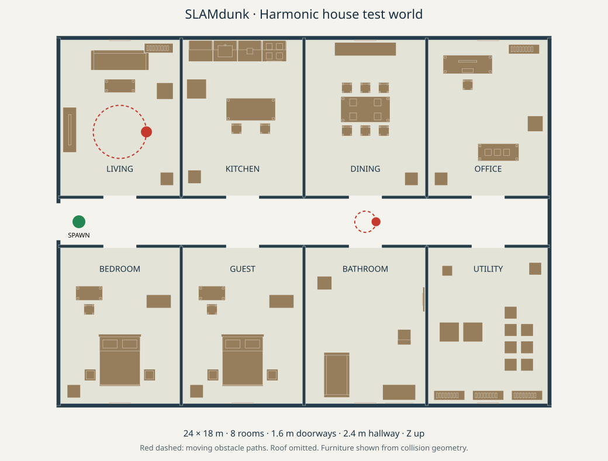

# Furnished house for Gazebo Harmonic

A self-contained SDF 1.9 environment for **Gazebo Harmonic / Gazebo Sim 8**,
including use on Ubuntu 24.04. All geometry, materials, lights, and collision
shapes are local primitives. No Fuel downloads, ROS installation, custom plugin
build, or model resource paths are required.



## Launch

Install [Gazebo Harmonic](https://gazebosim.org/docs/harmonic/install_ubuntu/),
then run from the repository root on Linux:

```bash
bash simulation/house/run_house.sh
```

For a baseline with all three moving objects held at zero velocity:

```bash
bash simulation/house/run_house.sh --static
```

For a server without the GUI:

```bash
bash simulation/house/run_house.sh -s
```

The equivalent direct command is:

```bash
gz sim --force-version 8 -r simulation/house/worlds/house.sdf
```

`-r` starts simulation immediately; Pause in the GUI pauses the motion too.
Use the GUI orbit/zoom controls to inspect the house from above, or follow a
robot after inserting it. The shell launcher resolves the world relative to
itself and can also be called outside the repository.

## Layout and test content

- 24 × 18 m house, 3.2 m walls; roof omitted for inspection from above.
- Eight rooms: living room, kitchen, dining room, office, main bedroom, guest
  bedroom, bathroom, and utility/storage room.
- A 2.4 m central hallway connects every room. Room doors have 1.6 m openings
  and 2.2 m headroom; the west exterior entrance is 1.8 m wide.
- 188 static models and 341 static collision shapes: sofa, TV, tables with
  individual legs, chairs, stocked shelves, kitchen island/counters/appliances,
  beds, wardrobes, lamps, plants, bathroom fixtures, crates, and laundry equipment.
- Different floor and object colors support RGB landmarks; shelves, table
  undersides, narrow furniture legs, and tall cabinets provide varied LiDAR and
  depth returns. Furniture is fixed for repeatable baseline mapping.
- Suggested drone spawn: **(-11, 0, 1)** m, yaw 0, facing east (+X).
  Green disk marks the spawn. Keep indoor flight below door headers when
  crossing walls (allow clearance for the complete drone body).
- A shared floor slab has its top at Z=0; Z is up, positions are metres,
  angles radians. `layout.json` records room centers and patrol parameters.

## Moving obstacles

Motion starts automatically using Harmonic's built-in
[JointController](https://gazebosim.org/api/sim/8/classgz_1_1sim_1_1systems_1_1JointController.html).
Every moving part has collision geometry. The two patrol objects are
world-anchored joint mechanisms with invisible constraints, intended as
repeatable moving obstacles rather than mobile robot dynamics.

| Model | Motion | Location / sweep | Default speed |
| --- | --- | --- | --- |
| `living_patrol` | Red cylindrical cart follows a circle | Center (-9, 4.4), radius 1.3 m; height 0.65 m | 0.22 rad/s (~28.6 s/lap) |
| `hall_patrol` | Tall yellow obstacle follows a small circle across the hallway | Center (3, 0), radius 0.52 m; height 1.2 m | -0.35 rad/s (~18 s/lap) |
| `dining_ceiling_fan` | Two collidable blades rotate overhead | Center (3, 5.5, 2.8), blade span 2.2 m | 1.4 rad/s |

The static world holds these same mechanisms at zero speed; model names,
collision geometry, and lighting are identical. To stop a moving object or
change speed while the simulator is running, publish a velocity in rad/s:

```bash
gz topic -t /model/living_patrol/joint/orbit/cmd_vel -m gz.msgs.Double -p 'data: 0.0'
gz topic -t /model/hall_patrol/joint/orbit/cmd_vel -m gz.msgs.Double -p 'data: 0.2'
gz topic -t /model/dining_ceiling_fan/joint/spin/cmd_vel -m gz.msgs.Double -p 'data: 0.0'
```

The patrol link frames sit at the centers of their orbits; their geometry and
centers of mass are offset from those frames. Track the **body link's rotation**
or its collision geometry to observe movement, rather than expecting its frame
origin to translate. Patrol geometry position is center + radius × (cos θ, sin θ).

## Robot and ROS integration

This world supplies the environment; it does not include a drone, flight
controller, or mapper. `UserCommands`, `SceneBroadcaster`, Ogre2 `Sensors`, and
`Imu` systems are enabled for insertion and sensor simulation. For example,
after starting this world, insert your **Harmonic-compatible** robot SDF:

```bash
gz service -s /world/house_test/create --reqtype gz.msgs.EntityFactory \
  --reptype gz.msgs.Boolean --timeout 5000 \
  --req 'sdf_filename: "/absolute/path/to/robot.sdf", name: "test_drone", pose: {position: {x: -11, y: 0, z: 1}}'
```

The robot must supply its own sensors, controller, and any other required
systems. ROS applications additionally need suitable `ros_gz_bridge` mappings
for clock, sensor, pose, and command topics. Sensors alone do not make a drone
fly.

The existing `integration/sando_reference` and `vendor/sando` launch pipeline
targets **Gazebo Classic**. Its Classic plugins and `gazebo_ros` launch setup
cannot load directly in Harmonic. This environment is separate from that
pipeline; porting the robot/plugins and ROS bridge is additional work. Harmonic
means Gazebo Sim 8; Ubuntu 24.04 is an OS version, not a Gazebo major version.

## Regenerate and verify

Both ready-to-run SDF worlds are checked in. Node.js (18+) is needed only if
editing the authoring source:

```bash
node simulation/house/generate_house.mjs
```

The generator validates unique model names, positive geometry extents, clear
spawn and room entrances, and conservative complete patrol swept volumes
against all static collision geometry. It also generates `layout.json` and
`floorplan.svg` from the same geometry.

On a Harmonic host, validate with libsdformat and exercise the physics/plugins:

```bash
gz sdf -k simulation/house/worlds/house.sdf
gz sdf -k simulation/house/worlds/house_static.sdf
gz sim --force-version 8 -s -r --iterations 1500 -v 3 simulation/house/worlds/house.sdf
```

For visual acceptance, launch the GUI, confirm all eight rooms are reachable,
watch both patrols complete a lap and the fan rotate, then compare the static
baseline. Insert the intended drone and check actual RGB/depth/LiDAR data
before accepting mapping performance.

Creation-time checks passed for generation, layout constraints, and XML
structure. Gazebo/WSL were unavailable on the authoring Windows host, so
libsdformat validation, physics, rendering, and robot sensor behavior still
require the Harmonic runtime checks above.
